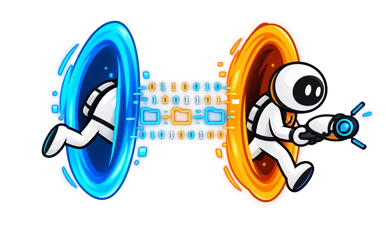

<p align="center">
  
</p>

<h1 align="center">Pi Agent Teleport</h1>

<p align="center">Move a running Pi Coding Agent session between directories, Git worktrees, and remote machines.</p>

<p align="center"><em>Give your agent a teleportation gun.</em></p>

<p align="center">
  <a href="https://www.npmjs.com/package/pi-agent-teleport"></a>
  <a href="https://www.npmjs.com/package/pi-agent-teleport"></a>
  <a href="https://github.com/alexshpunt/pi-agent-teleport/actions/workflows/ci.yml"></a>
  <a href="./LICENSE"></a>
</p>

Pi normally lives in the directory where you started it. Teleport lets the agent move
to another directory, repository, Git worktree, or remote machine and jump back when
the job is done. The conversation continues in the same session.

## Install

```bash
pi install npm:pi-agent-teleport
```

Requires Pi 1.3 or newer, Node.js 22.19 or newer, and a saved Pi session.

## Use it

Ask the agent in plain language:

```text
Move this session to /root/dev/my-other-repo and continue there.

Create an isolated worktree for the login fix, move into it, and continue the task.

Go back to the previous repository and remove the worktree you created.

Show where this session has been.
```

The agent handles the move. There are no slash commands to remember.

Local moves work with or without Herdr and stay in the current terminal. Creating and
removing worktrees uses Git without opening or closing Herdr panels. Other agents and
unrelated panes stay open.

In an interactive terminal, Teleport reports the session's folder with the standard
OSC 7 sequence (`ESC ] 7 ; file://<host>/<path> ESC \`) when a session starts and after
every move, and clears it when Pi quits. Terminals that read OSC 7, such as Herdr App,
show the agent under its current folder, also on Windows, where Pi's process folder is
not visible to them. Inside herdr-core, the URI includes the reporter's PID and a
process token issued by its holder. Herdr uses the token to reject an old replay and
recognize Pi behind shell wrappers. Cores without process-token support need an update;
terminals opened before the update need to be reopened. For a Windows UNC folder,
Teleport puts the reporting machine in the URI's host and percent-encodes the UNC path.
Herdr understands this form; other terminals may not. Print, JSON and RPC modes write
nothing.

## Remote machines

```text
Move this session to ssh://buildbox/home/me/project, confirm where you are, then come back.
```

The agent really runs on the remote machine after moving; it is not just sending
commands over SSH. The conversation and session identity follow it.

Before moving:

- Install the same Teleport build on both machines. Pi versions may differ; Teleport
  does not upgrade or downgrade either installation.
- Run Herdr on both machines. Add the destination as a saved direct Herdr machine.
  Address it by its SSH alias. From a Herdr App terminal, its machine name works too,
  as `hc machine ls` lists them: `ssh://laptop-wsl/root/dev/project` and
  `ssh://mesh-zinlaptop-wsl/root/dev/project` reach the same machine. Native Herdr
  machine IDs are not accepted as targets. When moving from an App-managed remote
  terminal to the computer hosting its window, Teleport identifies that desktop from
  the source workspace, tab and terminal instead.
- Set up key-based SSH access and host-key trust. Put connection options in SSH config.
  The SSH server must allow remote forwarding: Unix sockets for Unix destinations,
  or loopback TCP for Windows destinations.
- Prepare the destination directory and configure Pi there with its own model and
  authentication. Teleport does not copy your repository, credentials, settings, or
  other extensions.

Keep the original computer awake and connected until the agent returns. Brief
disconnections can recover, but a prolonged connection loss may need manual recovery.

If a move is reported as unconfirmed, ask the agent to inspect it before retrying.
Destination readiness has no time limit after launch. Teleport cancels that startup
only on a reported failure or an observed exit. The earlier Pi installation probe has
a three-minute limit.

### Herdr App from WSL

In a WSL terminal of the Windows Herdr App, Teleport finds the App's command-line
program and the machine name the App lists the terminal under, with no setup. The
program is the first found of `PI_HERDR_APP_CLI`, `HERDR_APP_BIN`, `herdr-app` or
`herdr-app.exe` on `PATH`, and the Windows installer's folder. The machine is read from
the App's listing by the terminal, tab and space IDs together. Set `PI_HERDR_APP_CLI`
to a full path, or `PI_HERDR_APP_MACHINE` to a machine name (empty for the App's own
machine), when the automatic choice is wrong.

## Worktrees and safety

Ask Teleport to create a worktree when you want a separate checkout for a task.
It only removes worktrees it created and recorded. Removal requires a clean checkout
with no extra panes or running commands; there is no force option. Git refuses to
delete an unmerged branch.

When Windows Pi works in a `\\wsl.localhost\<distro>\...` or `\\wsl$\<distro>\...`
folder, Teleport runs Git inside that WSL distribution. Git must be installed there.
Worktree metadata stays usable by Linux Git; no Windows `safe.directory` exception
or global Git configuration change is needed.

Changes must be committed or otherwise handled before removal. A worktree separates
checkouts; it is not a security sandbox.

Teleport preserves the conversation, not unsaved in-memory state inside extensions.
Those extensions need their own way to restore state after a move.

## Technical documentation

See [handoff and recovery](docs/handoff.md) for tool actions, Herdr behavior,
state storage, failure handling, and development commands.

## License

MIT
