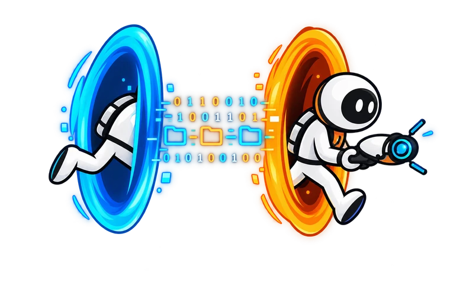

<p align="center">
  
</p>

<h1 align="center">Pi Agent Teleport</h1>

<p align="center">Move a running Pi Coding Agent session between directories, Git worktrees, and remote machines.</p>

<p align="center"><em>Give your agent a teleportation gun.</em></p>

<p align="center">
  <a href="https://www.npmjs.com/package/pi-agent-teleport"></a>
  <a href="https://www.npmjs.com/package/pi-agent-teleport"></a>
  <a href="https://github.com/alexshpunt/pi-agent-teleport/actions/workflows/ci.yml"></a>
  <a href="./LICENSE"></a>
</p>

Pi normally lives in the directory where you started it. Teleport lets the agent move
to another directory, repository, Git worktree, or remote machine and jump back when
the job is done. The conversation continues in the same session.

## Install

```bash
pi install npm:pi-agent-teleport
```

Requires Pi 1.3 or newer, Node.js 22.19 or newer, and a saved Pi session.

## Use it

Ask the agent in plain language:

```text
Move this session to /root/dev/my-other-repo and continue there.

Create an isolated worktree for the login fix, move into it, and continue the task.

Go back to the previous repository and remove the worktree you created.

Show where this session has been.
```

The agent handles the move. There are no slash commands to remember.

Local moves work with or without Herdr. In Herdr, Git checkouts appear as workspaces
grouped with their repository. Other agents and unrelated panes stay open.

## Remote machines

```text
Move this session to ssh://buildbox/home/me/project, confirm where you are, then come back.
```

The agent really runs on the remote machine after moving; it is not just sending
commands over SSH. The conversation and session identity follow it.

Before moving:

- Install the same Teleport build on both machines. Pi versions may differ; Teleport
  does not upgrade or downgrade either installation.
- Run Herdr on both machines. Add the destination as one enabled saved Herdr machine
  using the same SSH alias as the address.
- Set up key-based SSH access and host-key trust. Put connection options in SSH config.
  The SSH server must allow Unix-socket forwarding.
- Prepare the destination directory and configure Pi there with its own model and
  authentication. Teleport does not copy your repository, credentials, settings, or
  other extensions.

Keep the original computer awake and connected until the agent returns. Brief
disconnections can recover, but a prolonged connection loss may need manual recovery.

If a move is reported as unconfirmed, ask the agent to inspect it before retrying.
A timeout does not necessarily mean the move failed.

## Worktrees and safety

Ask Teleport to create a worktree when you want a separate checkout for a task.
It only removes worktrees it created and recorded. Removal requires a clean checkout
with no extra panes or running commands; there is no force option. Git refuses to
delete an unmerged branch.

Changes must be committed or otherwise handled before removal. A worktree separates
checkouts; it is not a security sandbox.

Teleport preserves the conversation, not unsaved in-memory state inside extensions.
Those extensions need their own way to restore state after a move.

## Technical documentation

See [handoff and recovery](docs/handoff.md) for tool actions, Herdr behavior,
state storage, failure handling, and development commands.

## License

MIT
